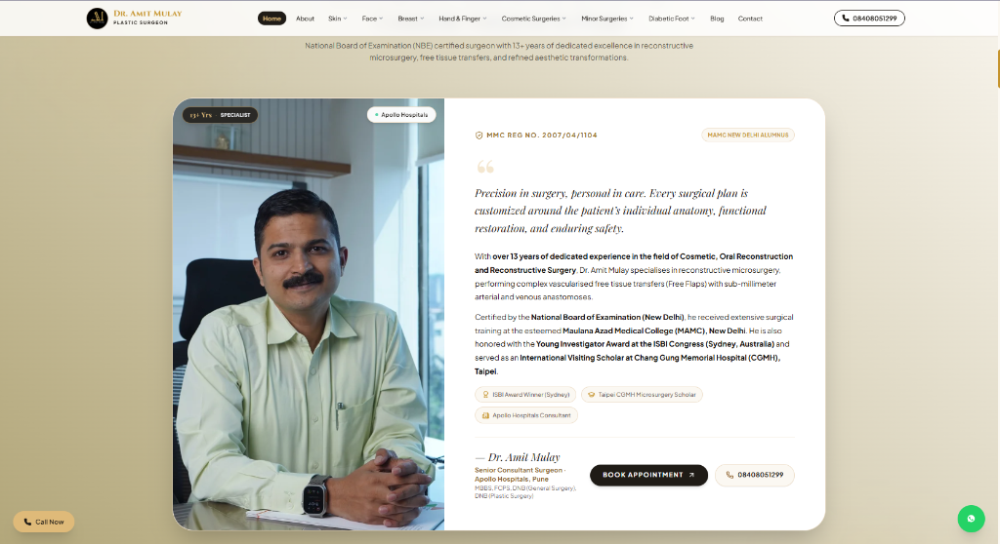
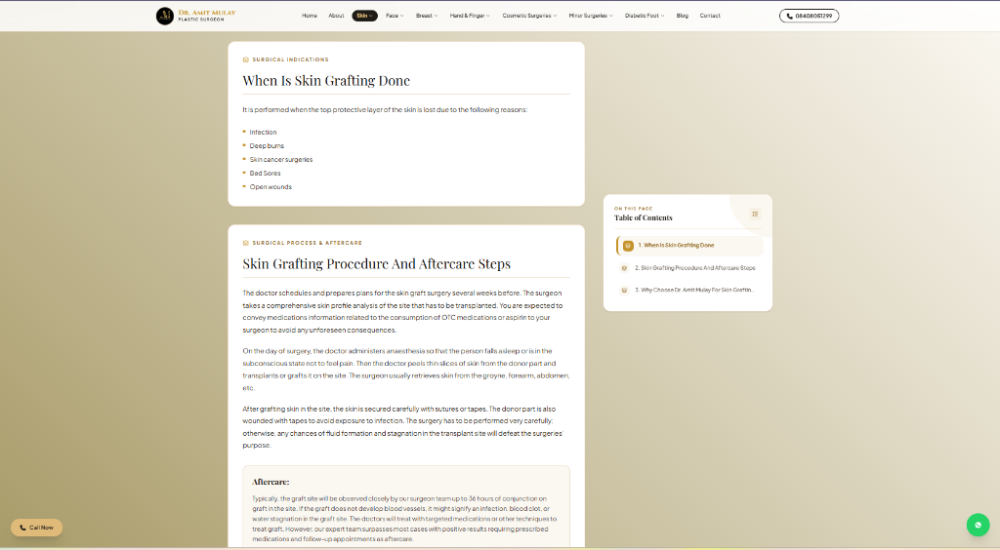
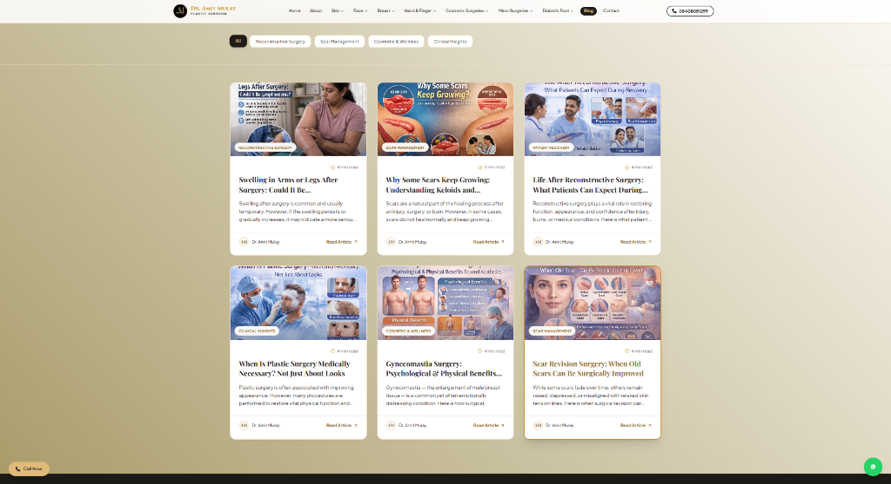

# Dr. Amit Mulay | Plastic, Reconstructive & Aesthetic Surgeon Portal

> Official website and patient consultation portal for **Dr. Amit Mulay** — Consultant Plastic, Reconstructive, and Aesthetic Surgeon (Pune & PCMC). Built with a "Quiet Luxury" medical aesthetic using React 19, Vite, Tailwind CSS v4, and Framer Motion.

---

## 📸 Interface Preview

### 1. Doctor Profile & Hero Section
*Showcasing clinical credentials, affiliations (Apollo Hospitals, MAMC Alumnus), and rapid consultation access.*



---

### 2. Surgical Procedure & Clinical Protocol Guide
*Comprehensive patient guide detailing indications, surgical steps, aftercare protocols, and interactive Table of Contents navigation.*



---

### 3. Patient Education & Clinical Insights
*Category-filtered medical articles covering reconstructive care, scar management, cosmetic surgery, and recovery insights.*



---

## ✨ Key Features

- **Comprehensive Clinical Procedures Registry:**
  - Detailed procedure pages and quick-view modals covering cosmetic surgery, reconstructive microsurgery, breast restoration, burn care, and hand surgery.
  - Interactive table-of-contents and procedure search with real-time filtering.
- **Appointment & Consultation Scheduling:**
  - Integrated booking system supporting both in-clinic visits and virtual consultations.
- **Patient Journey & Clinical Philosophy:**
  - Step-by-step guidance outlining initial consultation, pre-operative planning, surgical execution, and post-operative recovery.
- **Academic Credentials & Affiliations:**
  - Showcases qualifications (MBBS, DNB - MAMC New Delhi, CGMH Fellow), hospital network affiliations, and research journals.
- **Live Theme & Gradient Customizer:**
  - Interactive palette and gradient customizer tailored for luxury clinic branding.
- **Fluid Micro-Animations & Responsive UI:**
  - Seamless responsive design optimized across mobile, tablet, and desktop with smooth Framer Motion micro-interactions.

---

## 🛠️ Tech Stack

- **Frontend Library:** [React 19](https://react.dev/)
- **Build Tool:** [Vite](https://vitejs.dev/)
- **Styling:** [Tailwind CSS v4](https://tailwindcss.com/) & Custom CSS Luxury Design System
- **Animations:** [Framer Motion](https://www.framer.com/motion/)
- **Icons:** [Lucide React](https://lucide.dev/)
- **Linter:** [Oxlint](https://oxc.rs/)

---

## 📂 Project Structure

```text
Project B HealthCraft/
├── public/                 # Static assets and API endpoints
├── screenshots/            # UI screenshots for documentation
│   ├── doctor-profile.png
│   ├── procedure-details.png
│   └── clinical-insights-blog.png
├── src/
│   ├── assets/             # Images, clinical illustrations & logos
│   ├── components/         # Reusable React components & pages
│   │   ├── AboutUsPage.jsx
│   │   ├── AppointmentModal.jsx
│   │   ├── BlogPage.jsx
│   │   ├── HeroSection.jsx
│   │   ├── MeetDoctor.jsx
│   │   ├── ProcedureDetailPage.jsx
│   │   └── ...
│   ├── data/               # Clinical procedures & blog datasets
│   │   ├── proceduresData.js
│   │   └── blogsData.js
│   ├── App.jsx             # Main routing & state controller
│   ├── main.jsx            # Application entrypoint
│   └── index.css           # Global luxury design tokens & styles
├── index.html
├── package.json
└── vite.config.js
```

---

## 🚀 Getting Started

### Prerequisites

Ensure you have [Node.js](https://nodejs.org/) (v18 or higher recommended) installed.

### Installation

1. Clone the repository:
   ```bash
   git clone https://github.com/Adityaror/Healthcare-platform.git
   cd "Healthcare-platform/Project B HealthCraft"
   ```

2. Install dependencies:
   ```bash
   npm install
   ```

3. Run development server:
   ```bash
   npm run dev
   ```

4. Build for production:
   ```bash
   npm run build
   ```

---

## 📄 License

This project is proprietary and developed for Dr. Amit Mulay's clinical practice. All rights reserved.
